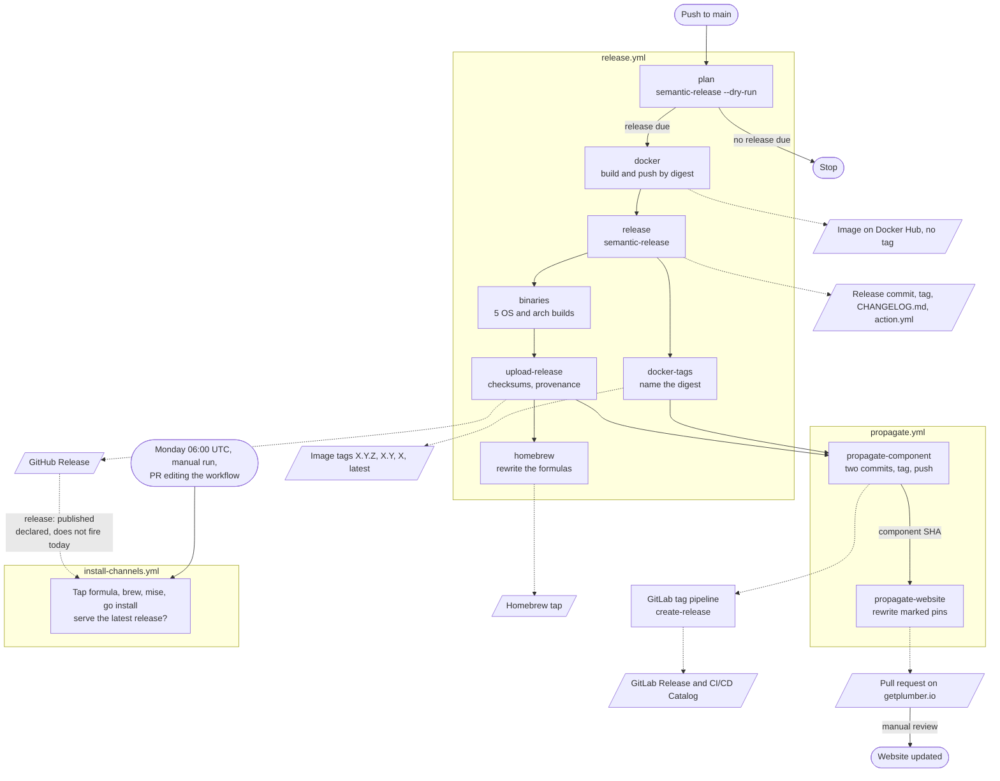

# Release process

How a push to `main` becomes a published Plumber release, and what to do when a step fails.

This describes the process as of v0.7.21. The source of truth is the code: [`release.yml`](../.github/workflows/release.yml), [`propagate.yml`](../.github/workflows/propagate.yml), [`install-channels.yml`](../.github/workflows/install-channels.yml), [`.releaserc.json`](../.releaserc.json) and `scripts/release-*`. For the list of version references and how the pin markers work, see [Releasing: version references](../CONTRIBUTING.md#releasing-version-references) in `CONTRIBUTING.md`.

## Summary

Every push to `main` asks semantic-release whether a release is due. If it is, the workflow builds the Docker image first, then creates the release commit and tag, then publishes everything else from that tag. Nobody starts a release by hand.

For v0.7.21, the tag existed about 4.5 minutes after the push, the GitHub Release after 6 minutes, and the whole run finished after 7 minutes.

## The flow

Solid arrows are the order of the jobs. Dotted arrows lead to what a job publishes. `homebrew` does not gate `propagate`: a failed Homebrew update leaves the GitLab component and the website PR untouched.

## Version

semantic-release 23.1.1 computes the version from the conventional commits since the last tag, using the rules in `.releaserc.json`:

| Commit | Release |
|--------|---------|
| `feat`, `fix`, `perf`, `refactor`, `chore` | patch |
| A breaking change (`!` or a `BREAKING CHANGE` footer) | minor |
| `docs`, `style`, `test`, `ci` | none |

When only commits of the last row landed, `plan` finds nothing to release and the run stops there.

The release commit is `chore(release): X.Y.Z [skip ci]`. `[skip ci]` is what stops it from starting another run.

semantic-release calls three scripts through `@semantic-release/exec`:

| Hook | Script | What it does |
|------|--------|--------------|
| `verifyReleaseCmd` | `scripts/release-plan.sh` | In `plan`, writes the next version to the job outputs. In `release`, refuses a version other than the one the image was built for |
| `prepareCmd` | `scripts/release-bump-version.sh` | Sets the version in `action.yml` and the image digest in `templates/plumber.yml`, inside the release commit |
| `successCmd` | `scripts/release-set-outputs.sh` | Writes `new_release_published` and `new_release_version`, which the later jobs gate on |

## The jobs of `release.yml`

| Job | What it does | Runs after | Credentials |
|-----|--------------|------------|-------------|
| `plan` | Dry run of semantic-release. Writes nothing, and outputs whether a release is due and its version | Push to `main` | Release App token |
| `docker` | Builds the amd64 and arm64 image for that version, pushes it by digest with no tag, attests it | `plan` | Docker Hub secrets, OIDC for the attestation |
| `release` | The real semantic-release. Pins the digest, writes `CHANGELOG.md`, creates the release commit and the tag, extracts the notes | `plan`, `docker` | Release App token |
| `docker-tags` | Puts `X.Y.Z`, `X.Y`, `X` and `latest` on the digest, then checks that `X.Y.Z` and `latest` resolve to it | `release`, `docker` | Docker Hub secrets |
| `binaries` | Builds Linux amd64 and arm64, macOS amd64 and arm64, Windows amd64 | `release` | None |
| `upload-release` | Generates `checksums.txt` and the provenance bundle, creates the GitHub Release with `gh release create` | `release`, `binaries` | `github.token`, OIDC for the attestation |
| `homebrew` | Rewrites `plumber.rb`, adds `plumber@X.Y.Z.rb`, pushes to the tap | `release`, `upload-release` | `HOMEBREW_TAP_TOKEN` |
| `propagate` | Calls `propagate.yml` | `release`, `docker`, `docker-tags`, `upload-release` | `GITLAB_COMPONENT_TOKEN`, release App token |

`plan` runs on `main` only, whatever the trigger. It holds a token that can push to `main` and runs commands taken from the checked-out `.releaserc.json`, so it never runs on unreviewed code. Every other job depends on it.

`gh workflow run release.yml` never releases. On `main` it plans, builds and pushes an untagged image, then stops. On any other branch nothing runs.

## Why the image is built before the tag

`templates/plumber.yml` pins the image by digest, and the digest only exists once the image is pushed. For a tagged commit to pin the image of its own version, the image has to exist before that commit does.

Up to v0.5.15 the image was built after the tag, so the digest could only land in a later commit, and every tag pinned the previous version's image. The order is now:

1. `plan` learns the version from a dry run, without writing anything.
2. `docker` builds the image for that version and pushes it by digest. It can be pulled as `getplumber/plumber@sha256:...`, but no tag points at it.
3. `release` pins that digest in the release commit, then tags that commit.
4. `docker-tags` adds the version tags and `latest` to that same digest.

Nothing public moves before the release exists: an image with no tag is not picked up by anyone, and `latest` moves last.

If a commit lands on `main` between `plan` and `release`, the image may no longer match what the release would be. `release` then refuses, either on the version mismatch (`PLANNED_VERSION`) or because the branch is behind. The next push to `main` releases both changes.

## `propagate.yml`

`propagate.yml` pushes a published release out to the repositories that reference it. It runs two jobs, in this order.

### GitLab component

`propagate-component` publishes [gitlab.com/getplumber/plumber](https://gitlab.com/getplumber/plumber):

1. Reads the digest from `templates/plumber.yml` at `main`, checks that its `#vX.Y.Z` label is this version, and compares it with the digest of the `docker` job.
2. Builds `RELEASE_NOTES.md` with `scripts/release-component-notes.sh`. These notes cover what changed in the component only, and link to the GitHub Release for the full changelog.
3. First commit, not tagged: syncs `templates/plumber.yml`, `RELEASE_NOTES.md` and the marked README pins.
4. Second commit, tagged `vX.Y.Z`: rewrites the README's own SHA-pinned usage examples to the SHA of the first commit.
5. Pushes `main` and the tag with `git push --atomic`, so neither can land without the other.
6. The GitLab tag pipeline (the `create-release` job of the component's `.gitlab-ci.yml`) creates the release. The CI/CD Catalog only accepts a release created by CI, so this is the only valid path.
7. Polls the GitLab Releases API for up to 10 minutes, and fails if the release does not appear. A successful push proves nothing about the pipeline.

There are two commits because a commit cannot contain its own SHA. The Catalog page renders the README from the tag, and that README must show a real, current commit. Its examples point one commit behind the tag, which behaves the same: the second commit only changes the README.

If the tag already exists on GitLab, the job skips the sync and only confirms the release, so running it again is safe.

### Website

`propagate-website` runs after the component job, because it needs the component SHA for its own usage examples. It rewrites the lines marked `pinned plumber version` in [getplumber.io](https://github.com/getplumber/getplumber.io) on a `release/auto-bump-vX.Y.Z` branch, closes older bump PRs as superseded, and opens a PR. The PR is merged by hand. If no marked line changed, no PR is opened.

## `install-channels.yml`

This workflow installs Plumber the way users do, and fails when a channel does not serve the latest GitHub release:

| Job | Check |
|-----|-------|
| `tap-formula` | The version in the tap's `plumber.rb`, retried for up to 20 minutes |
| `brew` | A real `brew install plumber` on macOS |
| `mise` | `mise install github:getplumber/plumber@latest` |
| `go-install` | `go install github.com/getplumber/plumber@latest`, retried for up to 20 minutes because the module proxy lags |

A red run means a channel is stale, not that the release is broken. See [Known gaps](#known-gaps) for when it really runs.

## What a release publishes

| Output | Where | Content |
|--------|-------|---------|
| Git tag and release commit | `getplumber/plumber` | `vX.Y.Z`, `CHANGELOG.md`, the pins in `action.yml` and `templates/plumber.yml` |
| GitHub Release | [Releases](https://github.com/getplumber/plumber/releases) | `plumber-linux-amd64`, `plumber-linux-arm64`, `plumber-darwin-amd64`, `plumber-darwin-arm64`, `plumber-windows-amd64.exe`, `checksums.txt`, `provenance.intoto.jsonl` |
| Docker image | `getplumber/plumber` on Docker Hub | amd64 and arm64, attested, tagged `X.Y.Z`, `X.Y`, `X` and `latest` |
| Homebrew tap | `getplumber/homebrew-plumber` | `plumber.rb` and `plumber@X.Y.Z.rb` |
| GitLab component | `gitlab.com/getplumber/plumber` | Two commits, tag `vX.Y.Z`, GitLab Release, CI/CD Catalog entry |
| Website PR | `getplumber/getplumber.io` | Pin bump, waiting for review |

The GitHub Action has no publish step of its own: users reference the tag, and `action.yml` already carries the version in the tagged commit.

## What stays manual

- Reviewing and merging the website PR. When a newer release lands first, its PR replaces the older one.
- Bumping the demo and example repositories that pin the component or the action by SHA, when the examples are refreshed.

## When something fails

Use **Re-run failed jobs**, never **Re-run all jobs**. Once the tag exists, a full re-run plans no release and skips every job after `plan`.

| Failure | What happened | What to do |
|---------|---------------|------------|
| `release` refuses because `main` moved | No tag was created. The image stays in the registry with no tag | Nothing. The next push to `main` releases both changes |
| `docker-tags` | The release exists and the pinned digest still pulls, but the version tags and `latest` did not move, and `propagate` is skipped | Re-run failed jobs |
| `binaries` or `upload-release` | The tag exists with no GitHub Release, and `homebrew` and `propagate` are skipped | Re-run failed jobs |
| `homebrew` | The tap is behind. Everything else went through | Re-run failed jobs |
| `propagate` | The GitHub Release is out, the component or the website PR is not | Re-run failed jobs, or `gh workflow run propagate.yml -f version=X.Y.Z` |
| Install channels is red | A channel is stale. The release is fine | Re-run the `homebrew` job, or wait for the Go module proxy, then `gh workflow run install-channels.yml` |

`gh workflow run propagate.yml -f version=X.Y.Z` works for the latest release only. An older version fails the template check on purpose, because `templates/plumber.yml` on `main` only carries the latest digest.

## Known gaps

- **`install-channels.yml` does not run on a release.** It declares `release: published`, and its header says the release is created with a GitHub App token so that the event fires. `upload-release` actually creates it with `github.token`, and events caused by that token start no workflow. The releases are authored by `github-actions[bot]`, and the run history shows only `schedule` and `pull_request` runs. A stale channel is therefore found by the Monday run, not right after the release.
- **`CONTRIBUTING.md` says `chore` triggers no release.** `.releaserc.json` gives it a patch, and that is what happens.
- **`CONTRIBUTING.md` lists a manual step that no longer exists.** It asks to update `@vX.Y.Z` usage comments in `templates/plumber.yml`, but those comments use a `<version>` placeholder.
- **`CONTRIBUTING.md` says the tag appears about ten minutes after the push.** It took about 4.5 minutes for v0.7.21.
