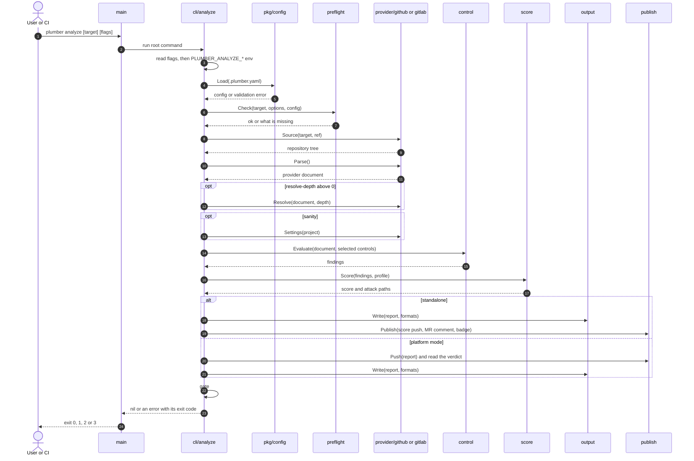
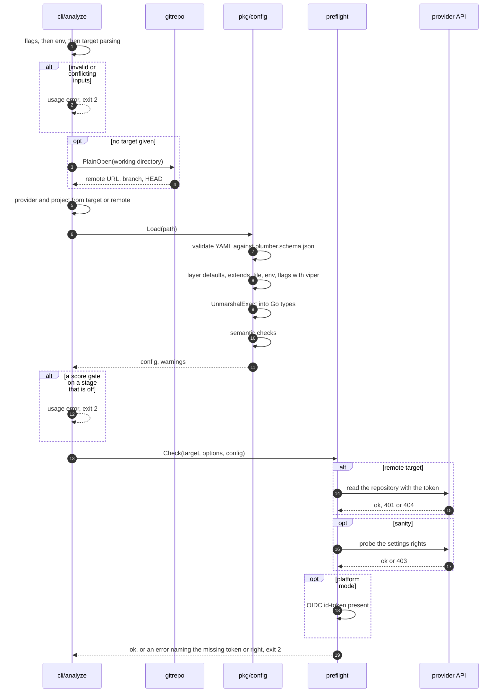
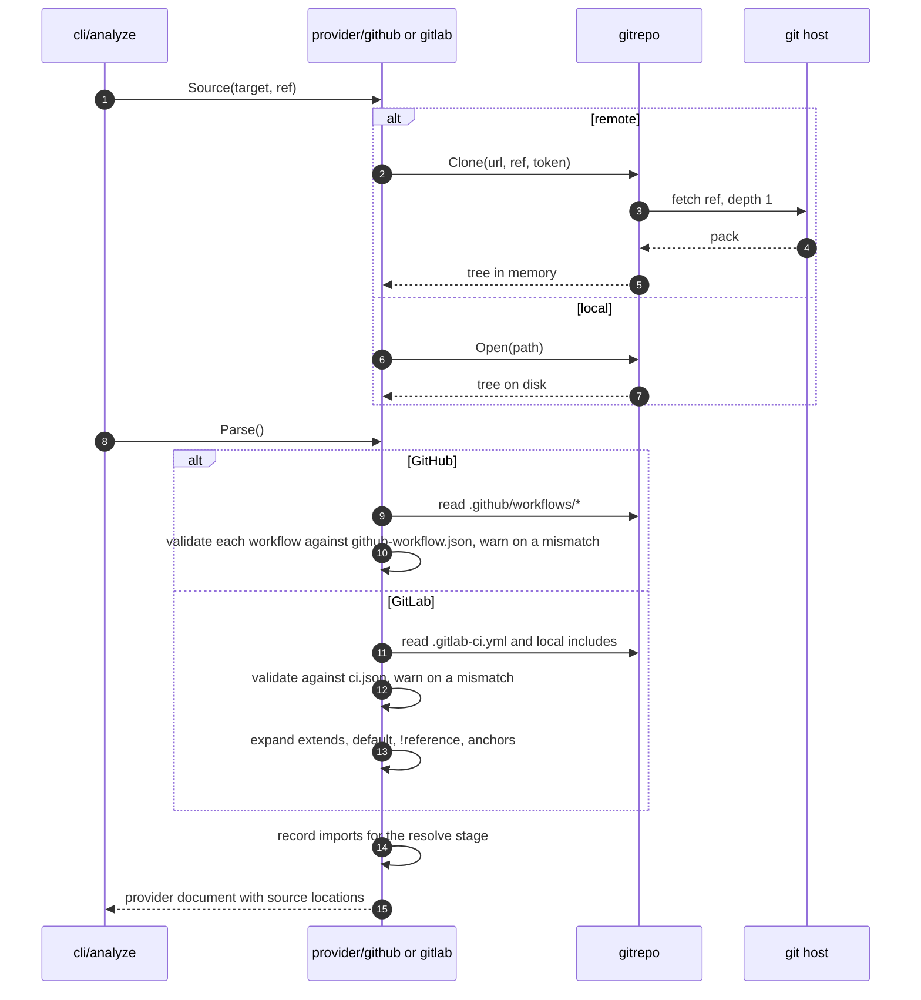
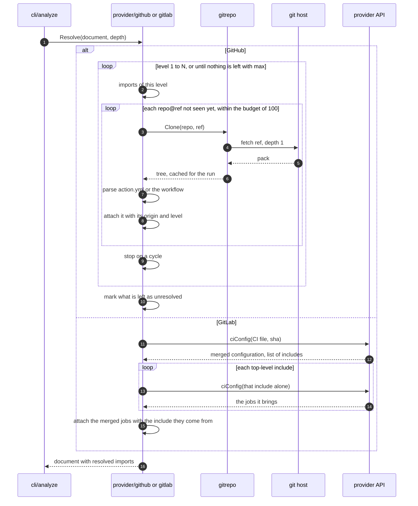
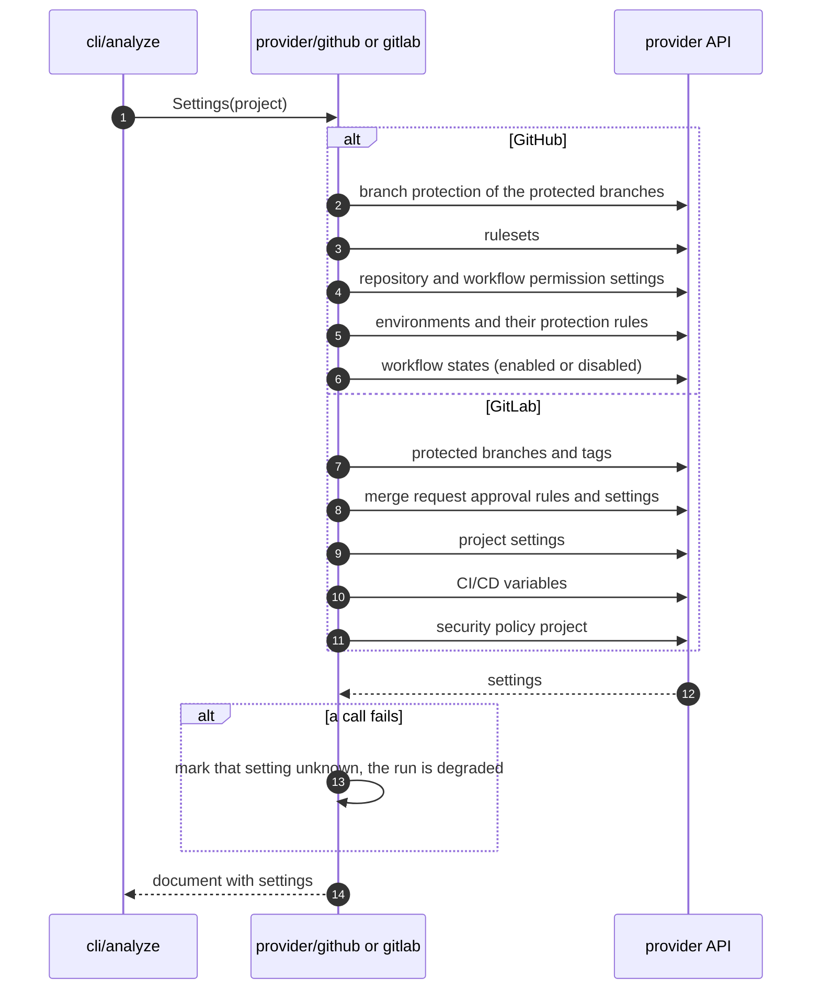
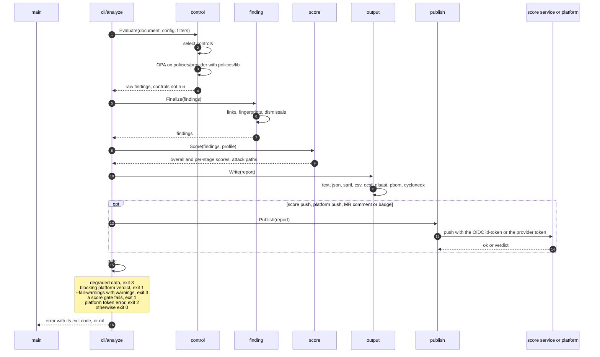

# The `analyze` flow

How the rewritten `plumber analyze` runs, stage by stage. It is the target of rewrite steps 2 and 9
to 13 in [project-structure.md](project-structure.md#rewrite-order), and its participants are the
packages of the [target layout](project-structure.md#target-layout). Today's CLI does several of
these stages differently; the last two sections list what stays and what changes.

A run has five stages before evaluation:

1. Preflight: check that the run can do what it is asked to do, such as a token that is set and
   has the rights the options need.
2. Source: a local run reads the clone on disk; a remote run clones the project in memory.
3. Static analysis of the workflows or `.gitlab-ci.yml`. This is the default and needs nothing
   else.
4. Resolve, with `--resolve-depth=N` or `max`: fetch the imported material (actions, reusable
   workflows, includes, components) down to N levels. On GitLab, the server merges the includes,
   so the depth is 0 or `max`.
5. Sanity, with `--sanity`: read the project settings, such as branch protection and rulesets.

The CLI is static by default. The Action and the component default to `--resolve-depth=max` and
`--sanity`, so a run in CI reads what today's CLI reads. The options that decide what a run checks
are also keys of the `analyze:` section of `.plumber.yaml`
([Configuration](project-structure.md#configuration)), and platform mode reads them from there
without forcing any.

There is no provider-neutral pipeline model. Each provider parses its own document, typed against
its official schema, and its own policies (`policies/github`, `policies/gitlab`) evaluate it with
shared Rego functions from `policies/lib`. Findings, the score and the attack paths are shared.
[drafts/repository-graph.md](drafts/repository-graph.md) keeps an alternative that isn't adopted:
a graph of the repository with a core both providers share. Move to it if policies turn out simpler
on a graph.

## Overview

## Inputs, configuration and preflight

Flags win over `PLUMBER_ANALYZE_*` variables, which `cli` binds through viper, and both win over
the `analyze:` section of `.plumber.yaml`. A score gate on a stage that is off, such as
`--min-score sanity=A` without `--sanity`, is a usage error (exit 2) before any request. A local run reads
its remote and `HEAD` with go-git. `pkg/config` loads `.plumber.yaml` in the four stages of
[Configuration](project-structure.md#configuration). Preflight checks only what the chosen options
need, with cheap API calls, and says what is missing. A local static run needs no token and no
network.

On GitHub, reading settings needs Administration read on the repository. On GitLab, it needs the
`read_api` scope and the Maintainer role, and preflight can read the token's scopes from
`personal_access_tokens/self`.

## Source and static analysis

A remote project is cloned at the ref (a branch, a tag or a commit) with depth 1, into memory, as
[Repository access](project-structure.md#repository-access) describes. A local project is read from
disk. The provider reads its CI files from the tree, validates them against the official schema
(SchemaStore's `github-workflow.json`, GitLab's `ci.json`) and expands them. Each node keeps its
file and line. A node that doesn't match the schema gives a warning and is kept as untyped; parsing
goes on.

## Resolve

`--resolve-depth` fetches what the document imports. The default is 0. An import left unfetched is
recorded as unresolved, so a policy can tell "not fetched" from "absent".

On GitHub, the provider fetches actions and reusable workflows level by level, down to N or, with
`max`, until nothing is left. Each repository and ref is cloned once per run. A run fetches at most
100 of them, as today; past that budget the rest stays unresolved and the run is degraded.

On GitLab, the server merges the includes, as in today's CLI: the provider sends the CI file to the
`ciConfig` GraphQL query and gets back the merged configuration, with every remote, project,
template and component include. One more call per top-level include tells which jobs each include
brought, so a finding in an include is told apart from one in the project's own files. GitLab
can't merge partway, so any depth above 0 means `max`, with a warning when it isn't `max`.

## Sanity

`--sanity` reads the settings that git doesn't carry and attaches them to the document as its
`settings` section. Off by default. On GitHub this includes the environments, the workflow states
and the default token permissions, which today's CLI reads on every run. Without `--sanity`, a run
analyzes every workflow file and says that their enabled or disabled state is unknown.

## Evaluation, score, outputs and exit code

`control` selects the controls from the config and the `--controls`, `--skip-controls` and
`--no-controls` flags, then evaluates the provider's policies on the document. A control that
needs resolved imports or settings reports "not run" when its stage was off, never "passed".

A run has three scores, plus the overall score of today:

- Static: findings in the repository's own files.
- Depth: findings in imported material (actions, reusable workflows, includes, components).
- Sanity: findings about the settings.

A finding counts in the score of the file it is in, whatever its control: the same forbidden image
tag counts in Static in `.gitlab-ci.yml` and in Depth in an included template. A score whose stage was
off isn't computed. The overall score stays what score push, the badge, the platform and
`plumberScore` read; the three scores sit next to it in the report. `--min-score` and the
`minScore` key gate on the overall score (`A`) or on each stage (`static=A,depth=C,sanity=A`).

## Behaviors kept from today's CLI

Each analyze step checks these against the old code:

- The order of the exit gate: degraded 3, blocking platform verdict 1, `--fail-warnings` 3, score
  gate 1, platform token error 2, otherwise 0. Other errors exit 2 (`cmd/root.go:60`,
  `finalizeRun` in `cmd/analyze_shared.go`).
- A flag wins over its `PLUMBER_ANALYZE_*` variable (`envKeys` in `cmd/analyze_gitlab.go:631`).
- Platform mode pushes before it writes the outputs; a standalone run writes first (`continueRun`
  in `cmd/analyze_shared.go`).
- A degraded run still writes every output, stamped as degraded.

## Behaviors that change

- Static by default: imports and settings are read only with `--resolve-depth` and `--sanity`.
  Today `analyze` resolves remote material on every run and reads settings whenever a control needs
  them. The Action and the component default to `--resolve-depth=max` and `--sanity`, so their
  users keep that coverage. [feature-inventory.md](feature-inventory.md) records the decision.
- GitHub environments, workflow states and default token permissions are read only with
  `--sanity`. Today they are read on every run.
- Three scores, Static, Depth and Sanity, next to the overall score, and a gate for each.
- The `analyze:` section of `.plumber.yaml` holds the options that decide what a run checks.
- A CI file that doesn't match its official schema gives a warning, and the node is kept as
  untyped.
- Preflight fails at the start, with exit 2, when a token or a right is missing. Today the run
  continues and reports the settings as unknown.
- `--threshold`, `--score` and the v0.2.x blocks of the JSON report are gone, with the other
  removals of [feature-inventory.md](feature-inventory.md#removals-in-v1).
- No shared pipeline model: today's `internal/ir` and the 75 policies on `input.pipeline` give way
  to one document and one policy set per provider.
