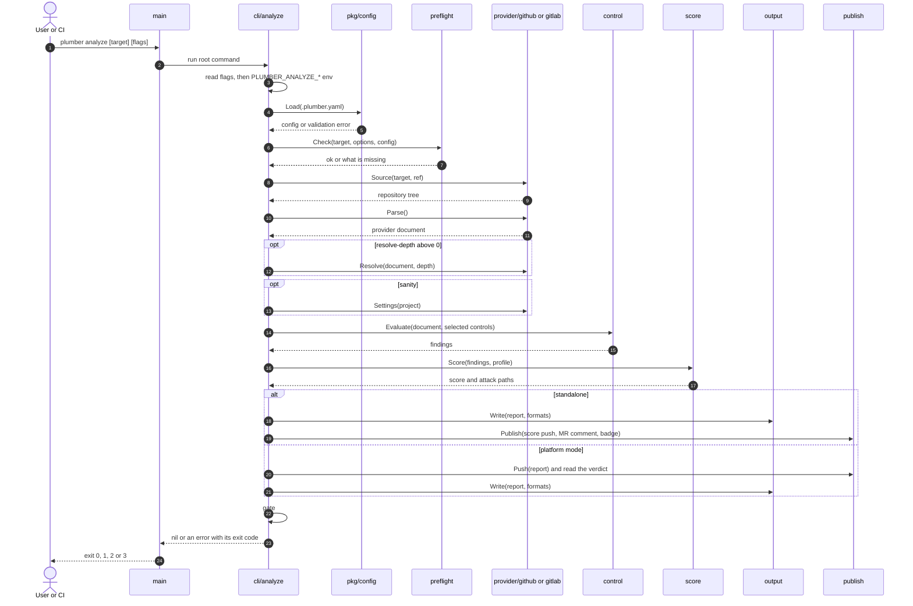
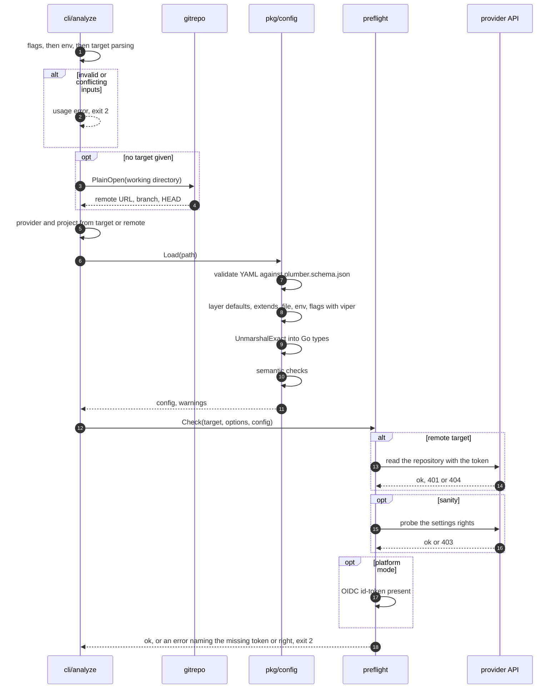
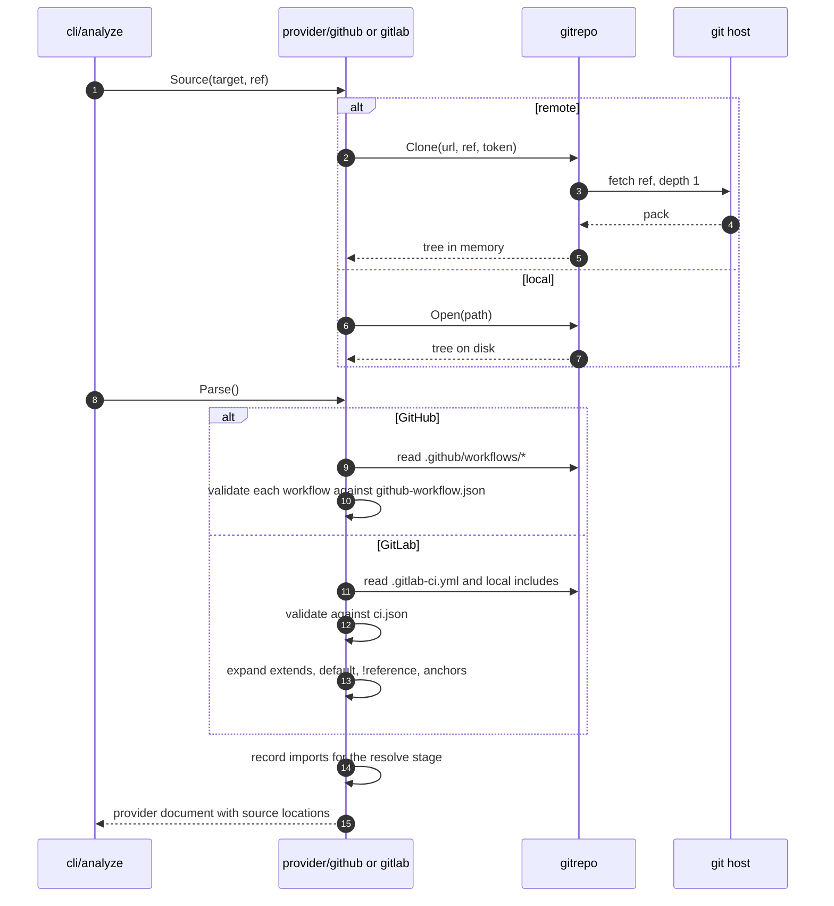
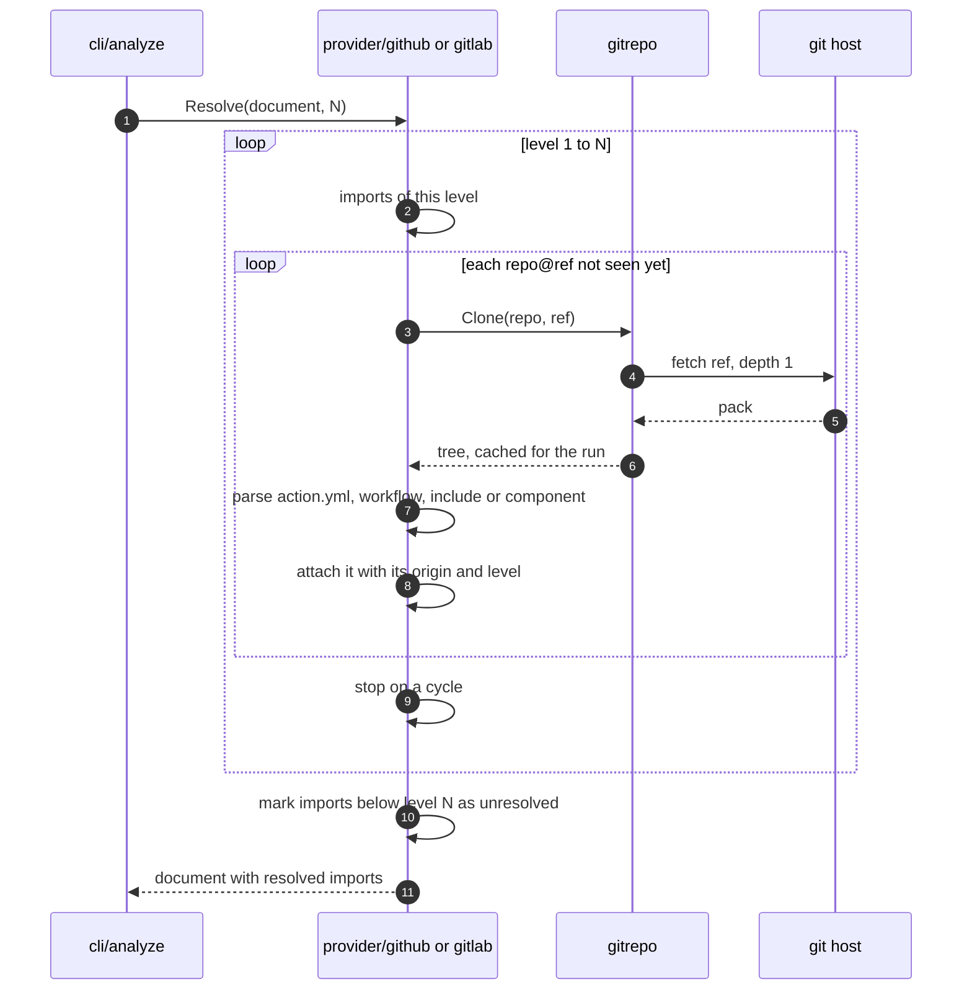
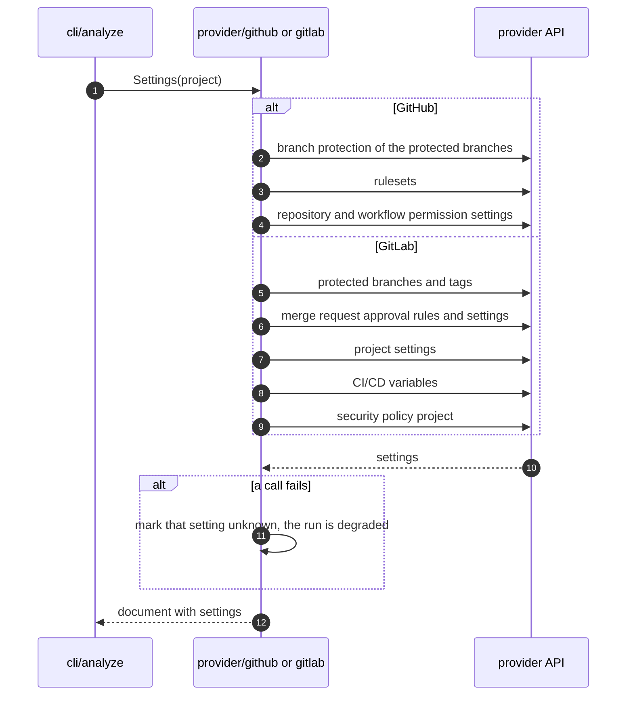

# The `analyze` flow

How the rewritten `plumber analyze` runs, stage by stage. It is the target of rewrite steps 8 to 12
in [project-structure.md](project-structure.md#rewrite-order), and its participants are the
packages of the [target layout](project-structure.md#target-layout). Today's CLI does several of
these stages differently; the last two sections list what stays and what changes.

A run has five stages before evaluation:

1. Preflight: check that the run can do what it is asked to do, such as a token that is set and
   has the rights the options need.
2. Source: a local run reads the clone on disk; a remote run clones the project in memory.
3. Static analysis of the workflows or `.gitlab-ci.yml`. This is the default and needs nothing
   else.
4. Resolve, with `--resolve-depth=N`: fetch the imported material (actions, reusable workflows,
   includes, components) down to N levels.
5. Sanity, with `--sanity`: read the project settings, such as branch protection and rulesets.

There is no provider-neutral pipeline model. Each provider parses its own document, typed against
its official schema, and its own policies (`policies/github`, `policies/gitlab`) evaluate it with
shared Rego functions from `policies/lib`. Findings, the score and the attack paths are shared.

## Overview

## Inputs, configuration and preflight

Flags win over `PLUMBER_ANALYZE_*` variables, which `cli` binds through viper. A local run reads
its remote and `HEAD` with go-git. `pkg/config` loads `.plumber.yaml` in the four stages of
[Configuration](project-structure.md#configuration). Preflight checks only what the chosen options
need, with cheap API calls, and says what is missing. A local static run needs no token and no
network.

On GitHub, reading settings needs Administration read on the repository. On GitLab, it needs the
`read_api` scope and the Maintainer role, and preflight can read the token's scopes from
`personal_access_tokens/self`.

## Source and static analysis

A remote project is cloned at the ref (a branch, a tag or a commit) with depth 1, into memory, as
[Repository access](project-structure.md#repository-access) describes. A local project is read from
disk. The provider reads its CI files from the tree, validates them against the official schema
(SchemaStore's `github-workflow.json`, GitLab's `ci.json`) and expands them. Each node keeps its
file and line.

## Resolve

`--resolve-depth=N` fetches what the document imports, level by level. Each repository and ref is
cloned once per run. An import left beyond depth N is recorded as unresolved, so a policy can tell
"not fetched" from "absent". The default depth is 0.

## Sanity

`--sanity` reads the settings that git doesn't carry and attaches them to the document as its
`settings` section. Off by default.

## Evaluation, score, outputs and exit code

`control` selects the controls from the config and the `--controls`, `--skip-controls` and
`--no-controls` flags, then evaluates the provider's policies on the document. A control that
needs resolved imports or settings reports "not run" when its stage was off, never "passed".

## Behaviors kept from today's CLI

Each analyze step checks these against the old code:

- The order of the exit gate: degraded 3, blocking platform verdict 1, `--fail-warnings` 3, score
  gate 1, platform token error 2, otherwise 0. Other errors exit 2 (`cmd/root.go:60`,
  `finalizeRun` in `cmd/analyze_shared.go`).
- A flag wins over its `PLUMBER_ANALYZE_*` variable (`envKeys` in `cmd/analyze_gitlab.go:631`).
- Platform mode pushes before it writes the outputs; a standalone run writes first (`continueRun`
  in `cmd/analyze_shared.go`).
- A degraded run still writes every output, stamped as degraded.
- `--threshold` alone uses the old percentage gate and switches the score gate off.

## Behaviors that change

- Static by default: imports and settings are read only with `--resolve-depth` and `--sanity`.
  Today `analyze` resolves remote material and reads settings on every run.
  [feature-inventory.md](feature-inventory.md) records the decision.
- Preflight fails at the start, with exit 2, when a token or a right is missing. Today the run
  continues and reports the settings as unknown.
- No shared pipeline model: today's `internal/ir` and the 75 policies on `input.pipeline` give way
  to one document and one policy set per provider.
